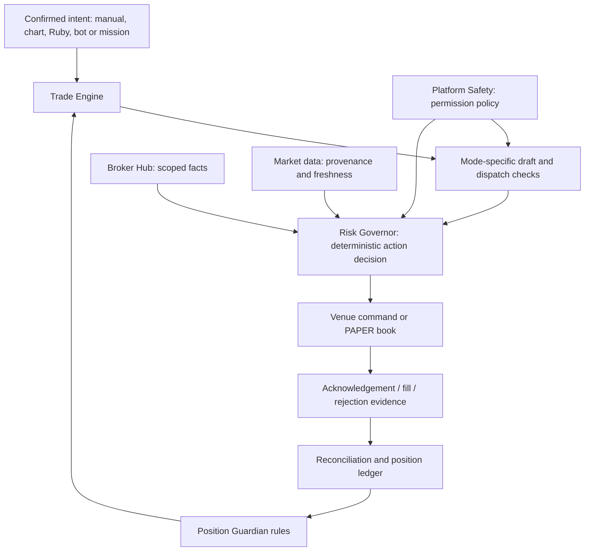

# ARX Tier 1 architecture

ARX AI — Analyze. Risk. eXecute. The rule is **one authority per responsibility**.
This map replaces the historical Build-B paper-only map. LIVE, DEMO and PAPER
are explicit modes; broker submission is not a confirmed fill. Completion is
measured by `scripts/arx-scorecard/rubric.json`, not a module or guard count.

## The five components and their jobs

| Component | Its job | Canonical boundary | Must not do |
|---|---|---|---|
| **Risk Governor** | Decide whether an action is within deterministic risk policy: effective limits, sizing, exposure, daily loss/drawdown, reward-to-risk and discipline. Return reasons and audit evidence. | `artifacts/api-server/src/lib/riskGovernor/enforce.ts` loads facts and audits; `preTrade.ts` evaluates; `limitSettings.ts` and `positionSizer.ts` own their respective policies. | Dispatch trades, invent account facts, or let Ruby/user interfaces bypass a block. |
| **Trade Engine** | Carry a confirmed intent through its mode's execution lifecycle, coordinating risk and safety and delegating venue mechanics. | `artifacts/api-server/src/lib/tradeEngine/pipeline.ts`; internal LIVE queue, DEMO queue/consumer and `paperVenue.ts`. | Silently convert LIVE to PAPER, let routes write command mailboxes, or call submission a fill. |
| **Position Guardian** | Supervise positions and decide protective close, intelligence exit, mission exit, trade health, scalp and trade-management actions. | `artifacts/api-server/src/lib/positionGuardian/manage.ts` and `rules.ts`; position persistence through `lib/positions/ledger.ts`. | Let individual rule families independently execute; mark a position closed before broker evidence. |
| **Broker Hub** | Supply broker/connection/account facts, identity, provenance, capabilities and freshness through a common read contract. | `artifacts/api-server/src/lib/brokerHub/readAdapters.ts`, `connections.ts`, `brokerHealthState.ts`, `mt5StateReader.ts` and `freshness.ts`. | Authorize or dispatch trades; equate stream health with execution readiness; substitute a platform balance for a user's account. |
| **Platform Safety** | Interpret platform/venue stop and execution controls and their scopes; own audited engagement/release policy. | `artifacts/api-server/src/lib/safety/platformSwitches.ts`, `tradingHalt.ts` and the scoped pause operations. | Implicitly release a stop on activation, re-arm on resume, or weaken safety when duplicate rows exist. |

Domain contracts and implementation history:
[Risk Governor](TIER1_RISK_GOVERNOR_SOURCE.md),
[Trade Engine](TIER1_TRADE_ENGINE_MODES.md),
[Position Guardian](TIER1_POSITION_GUARDIAN_RULES.md),
[Broker Hub](TIER1_BROKER_HUB_SOURCE.md),
[Platform Safety](TIER1_PLATFORM_SAFETY_SOURCE.md).
Historical sections in those documents describe their named rounds, not necessarily
current behavior. The completion report identifies superseding changes and evidence.

## How an action moves through the system

This is a responsibility diagram. Checks occur at confirmation and again at
venue dispatch/consume; individual venues retain transport, ownership, arming
and capability checks. Passing an early check never overrides a later refusal.
LIVE uses Phase B; DEMO uses its governed queue/consumer; PAPER books internal
orders without sending a broker command. Unsupported operations refuse explicitly.

## Supporting responsibilities

- **Position ledger** owns access to `arx_live_positions` and `live_positions`.
  Approved Option A retains both physical stores. Named views distinguish
  `UNCLOSED`, `EXPOSURE`, `CONFIRMED_OPEN` and `ALERT_ELIGIBLE`; these are different
  questions, not competing position truth. User/account/venue/ticket identity
  must survive every join. See [ledger](TIER1_POSITION_LEDGER.md),
  [views](TIER1_OPEN_POSITION_VIEW.md) and [merge decision](TIER1_POSITION_TABLE_MERGE_PLAN.md).
- **Paper book** owns automated `paper_orders` accounting and its risk facts.
  `paper_trades` is the manual journal; `trades` retains legacy history. Real-quote
  SIMULATED orders must retain real price provenance throughout their lifecycle.
  See [paper book](TIER1_PAPER_BOOK.md).
- **Market data** supplies observed prices with source and time. Missing/stale
  quotes cannot be fabricated into executable prices. Training simulation remains
  explicitly identified as simulation.
- **Ruby and intelligence** propose/explain. The LLM gateway owns model access;
  deterministic safety, risk, confirmation and execution remain outside the model.
- **Audit** records decisions, state transitions, requests and outcomes. Request,
  queued command, acknowledgement, partial fill and final fill are distinct facts.
- **API and dashboard** adapt canonical contracts and display their results.
  They do not recreate risk formulas, stop policy or broker readiness.
- **Smart Chart** displays canonical candles and feed quality. Its shell owns
  instrument/timeframe and setup context; the renderer owns viewport/series
  lifecycle; study calculators derive display-only indicators; the workbench
  owns local drawings/templates; the layout keeps comparison charts separate
  from the single gated trade ticket. It adds no execution authority. See the
  [feature acceptance report](SMART_CHART_ACCEPTANCE.md) and
  [TradingView/MT5 comparison](SMART_CHART_PLATFORM_COMPARISON.md).

## Verification and operational boundaries

Architecture evidence must cover authority, source, callers, contract and proof
for each domain. A shared wrapper alone does not prove consolidation. Guards
prevent known bypass shapes; behavioral tests establish action semantics. Static
checks cannot prove every dynamic runtime path.

The v2 scorecard is repository-owned and reproducible. The unavailable original
scorecard and its reported 68.7% are historical only. Missing production facts
remain UNKNOWN and do not prevent code verification. Conversely, passing local
checks does not establish production or broker readiness.

[The owner runbook](TIER1_OWNER_RUNBOOK.md) owns deployment prerequisites, explicit
legacy ownership and real DEMO validation. No architecture completion label
constitutes authorization to deploy, arm LIVE or place a real-money trade.
